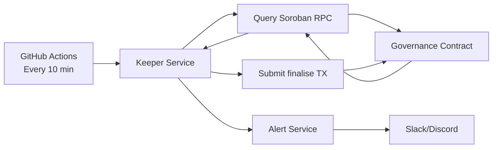

# Keeper Service Architecture

The keeper service is an automated bot that ensures expired proposals are finalized promptly without manual intervention.

## Problem Statement

Before the keeper service, expired proposals remained stuck in `Active` state until someone manually ran `scripts/finalise-expired-proposals.sh`. This created operational overhead and delayed proposal outcomes.

## Solution

The keeper service:
1. Polls the governance contract every 10 minutes
2. Identifies proposals where `end_time < now` and `state == Active`
3. Submits `finalise()` transactions for each expired proposal
4. Logs all attempts and alerts on failures

## Architecture



## Components

### 1. Keeper Service (`keeper-service/`)

TypeScript service that:
- Loads configuration from environment variables
- Polls for expired proposals
- Submits finalization transactions
- Handles errors and retries

### 2. Alert Service

Sends notifications when finalization fails:
- Slack webhook
- Discord webhook
- Email (optional)

### 3. GitHub Actions Workflow

Scheduled workflow (`.github/workflows/keeper-service.yml`):
- Runs every 10 minutes via cron schedule
- Can be triggered manually via `workflow_dispatch`
- Uploads logs as artifacts

## Deployment Options

### Option 1: GitHub Actions (Recommended)

**Pros:**
- No infrastructure to manage
- Free for public repositories
- Built-in logging and monitoring
- Secrets management via GitHub Secrets

**Cons:**
- 10-minute minimum interval (cron limitation)
- Must complete within 6 hours (GitHub Actions limit)

**Setup:**
1. Add secrets to GitHub repository settings:
   - `SOROBAN_RPC_URL`
   - `GOVERNANCE_CONTRACT_ID`
   - `KEEPER_SECRET_KEY`
   - `SLACK_WEBHOOK_URL` (optional)
   - `DISCORD_WEBHOOK_URL` (optional)

2. Enable GitHub Actions workflow

### Option 2: Self-Hosted Service

**Pros:**
- Custom polling interval (< 10 minutes possible)
- Full control over execution environment
- No GitHub Actions quotas

**Cons:**
- Requires infrastructure (VM, container orchestration)
- Must manage uptime, monitoring, logging

**Setup:**
1. Deploy to server/container platform
2. Set environment variables
3. Configure process manager (systemd, PM2, etc.)
4. Set up monitoring and alerting

## Configuration

See `keeper-service/.env.example` for all configuration options.

Key settings:
- `POLL_INTERVAL_MINUTES`: How often to check (default: 10)
- `KEEPER_SECRET_KEY`: Account that signs finalization transactions (needs XLM for fees)
- Alert webhooks for failure notifications

## Monitoring

### GitHub Actions

View workflow runs:
```
https://github.com/mercyJJ/cosmosvote/actions/workflows/keeper-service.yml
```

Download logs:
```bash
gh run download <run-id> -n keeper-logs-<run-number>
```

### Self-Hosted

Monitor via:
- Process logs (stdout/stderr)
- Alert notifications (Slack/Discord)
- Stellar block explorer (search keeper account)

## Security

- The keeper account only needs enough XLM for transaction fees
- `finalise()` is a permissionless function (anyone can call it)
- The keeper cannot modify proposals or vote
- Failed transactions do not affect on-chain state

## Cost Estimation

Per finalization:
- Base fee: ~0.00001 XLM
- Soroban resource fees: varies by contract state

For 100 proposals/month:
- ~0.001 XLM (~$0.0001 USD)

## Failure Handling

The keeper service handles failures gracefully:
1. Logs error details
2. Sends alert notification
3. Continues to next proposal
4. Retries on next polling cycle

Common failure scenarios:
- Proposal already finalized (harmless)
- Insufficient XLM balance (fund keeper account)
- RPC connection issues (transient, will retry)

## Future Enhancements

- [ ] Expose Prometheus metrics endpoint
- [ ] Add Grafana dashboard
- [ ] Support multiple governance contracts
- [ ] Implement exponential backoff for retries
- [ ] Add dry-run mode for testing

## Related

- Issue #132: [Product] Implement a proposal finalization keeper bot
- `scripts/finalise-expired-proposals.sh` - Manual finalization (still available)
- `docs/runbook.md` - Operational procedures
